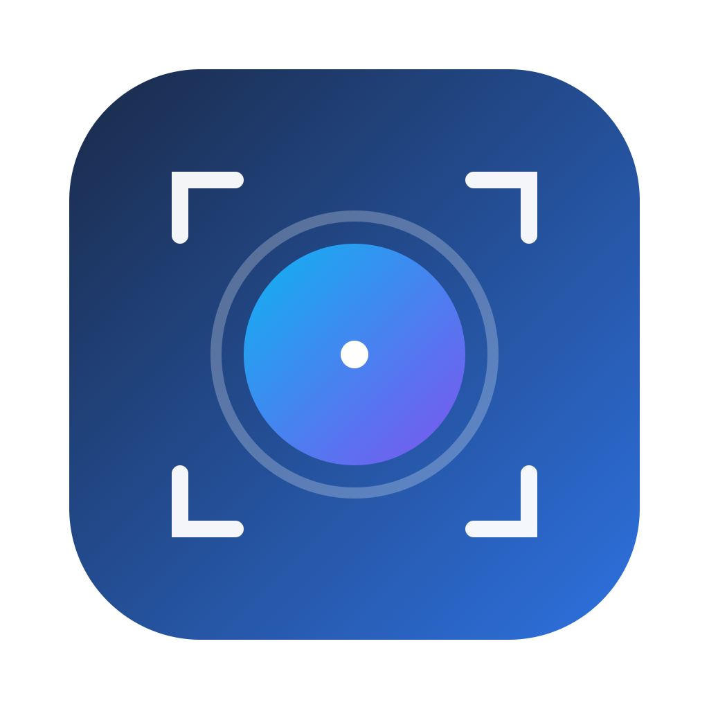

# CleanShot X for macOS

<p align="center">
  
</p>

<p align="center">
  <strong>An advanced, native macOS screenshot, screen recording, annotation, and productivity suite.</strong><br>
  Built 100% in pure Swift and native Apple frameworks. Lightweight, ultra-fast, and completely private.
</p>

<p align="center">
  <a href="https://github.com/akshat2474/CleanShot/releases/latest"></a>
  
  
  
</p>

---

## Quick Download

Download the ready-to-run macOS disk image (`.dmg`):

### [**Download CleanShot.dmg (Latest Release)**](https://github.com/akshat2474/CleanShot/releases/latest)

> **Important Installation Note:** Double-click `CleanShot.dmg` to open it, then **drag `CleanShot.app` into your Applications folder**. Do not run the app directly from inside the disk image window.

---

## Overview & Philosophy

macOS includes basic built-in screenshot utilities (`Cmd + Shift + 3` / `Cmd + Shift + 4`), but modern workflows require much more: seamless annotations, instant sharing without saving cluttered files to your desktop, scrolling capture for long documents, background styling for social media/documentation, and on-device text recognition.

**CleanShot** reproduces the functionality and polish of professional screen capture utilities in a single native, lightweight (~1.4 MB) package:

- **100% Native:** Built with AppKit, ScreenCaptureKit, CoreGraphics, Vision, and AVFoundation.
- **Zero Third-Party Dependencies:** No electron wrappers, no Node.js runtimes, no external libraries.
- **Privacy First & Offline:** 100% on-device processing. No telemetry, no network calls, no account required.
- **Ultra-Low Latency:** Millisecond-level capture and editing pipelines optimized for Apple Silicon (M1/M2/M3/M4) and Intel.

---

## Feature Highlights

### 1. Capture Modes
- **Area Capture (`Cmd + Shift + 4`):** Interactive marquee selection with live pixel dimensions and snapping.
- **Real-Time Magnifier Loupe:** 8x optical loupe under the cursor showing individual pixels, coordinate position, and live hexadecimal/RGB color codes.
- **Freeze Screen Buffer:** Multi-monitor frame freezing before selection to capture transient UI states, dropdown menus, and hover effects without jitter.
- **Window Capture (`Cmd + Shift + 5`):** Hover-based window detection inspecting the CoreGraphics window list with automatic window corner clipping and drop shadow synthesis.
- **Fullscreen (`Cmd + Shift + 3`):** Capture of all active connected displays.
- **Previous Area (`Cmd + Shift + 6`):** Repeat capture using the exact coordinates and dimensions of your last selection.
- **Self-Timer (`Cmd + Shift + 8`):** 5-second countdown timer for staging complex multi-step interactions.

### 2. Ephemeral Quick Access Overlay
- **Floating HUD:** Immediately after any capture, a clean, non-activating floating preview panel appears in the lower-right corner of your screen.
- **1-Click Quick Actions:**
  - **Copy:** Copy the image to clipboard and dismiss the HUD.
  - **Save:** Save to your default Pictures/Screenshots directory.
  - **Pin:** Float the screenshot on top of all other windows with adjustable opacity for side-by-side reference.
  - **Annotate:** Open directly in the vector markup editor.
  - **Delete:** Discard unwanted captures immediately.
- **Direct Drag-and-Drop:** Drag the preview thumbnail directly into Slack, Discord, Figma, GitHub, Notion, Messages, or Terminal without saving a file to your desktop.

### 3. Scrolling Capture (`Cmd + Shift + 7`)
- Automated synthetic vertical scrolling and real-time **Normalized Cross-Correlation (NCC)** image stitching.
- Stitch long web pages, PDF documents, source code listings, and chat histories into a single high-resolution image.

### 4. Vector Annotation & Markup Studio
- Dedicated vector canvas editor with full undo/redo support:
  - **Smart Arrows:** Directional arrows with customizable stroke widths and colors.
  - **Shapes:** Rectangles, rounded rectangles, and ellipses.
  - **Auto-Incrementing Step Counters:** Numbered badges (`1`, `2`, `3`...) that automatically increment with each click for creating tutorials and bug reports.
  - **Text Callouts:** Rich typography callouts with background badges.
  - **Highlighters & Freehand Pen:** Smooth vector drawing.
  - **Redaction Filters:** Non-destructive Gaussian blur, mosaic pixelation, and spotlight focus to conceal sensitive tokens, passwords, or personal data.

### 5. Background Styler & Social Beautifier
- Transform raw application windows into presentation-ready visuals:
  - **Backdrops:** Gradients (indigo-purple, ocean, sunset), solid colors, transparent canvas, or desktop wallpaper.
  - **Framing:** Customizable padding (0 to 100px) and corner radius smoothing.
  - **Shadows:** Multi-layer diffuse ambient drop shadows for realistic depth.

### 6. Screen Recording & Animated GIF Engine (`Cmd + Shift + 9`)
- **ScreenCaptureKit:** 60 FPS hardware-accelerated video capture with minimal CPU overhead.
- **Dual Audio:** Simultaneous internal system audio loopback and external microphone capture.
- **Webcam Picture-in-Picture:** Draggable floating circular webcam overlay bubble with real-time preview.
- **GIF Exporter:** Palette quantization engine to generate optimized, lightweight animated GIFs or MP4 video files.

### 7. On-Device OCR & QR Code Scanner (`Cmd + Shift + 2`)
- Powered by Apple's `Vision` framework (`VNRecognizeTextRequest` & `VNDetectBarcodesRequest`).
- Select any screen region to extract unselectable text, tabular data, or QR code links directly to your clipboard.

### 8. Desktop Clutter Hider
- Hides all desktop icons and folders using a specialized `NSWindow` overlay positioned at `kCGDesktopIconWindowLevel`.
- Provides a clean desktop backdrop for screenshots and screen recordings with zero Finder restart latency.

---

## Keyboard Shortcuts

CleanShot registers system-wide Carbon global hotkeys for instant access from any application:

| Action | Shortcut | Key Combination | Description |
|:---|:---:|:---:|:---|
| **Capture Area** | `⌘ ⇧ 4` | `Cmd + Shift + 4` | Interactive marquee selection with 8x loupe |
| **Capture Window** | `⌘ ⇧ 5` | `Cmd + Shift + 5` | Auto-detect window bounds with shadow/styling |
| **Capture Fullscreen** | `⌘ ⇧ 3` | `Cmd + Shift + 3` | Capture all connected displays |
| **Capture Previous Area** | `⌘ ⇧ 6` | `Cmd + Shift + 6` | Re-capture previous crop coordinates |
| **Scrolling Capture** | `⌘ ⇧ 7` | `Cmd + Shift + 7` | Continuous scrolling capture and stitch |
| **Self-Timer** | `⌘ ⇧ 8` | `Cmd + Shift + 8` | 5-second delayed capture countdown |
| **Recognize Text (OCR)** | `⌘ ⇧ 2` | `Cmd + Shift + 2` | Extract text or QR codes directly to clipboard |
| **Record Screen** | `⌘ ⇧ 9` | `Cmd + Shift + 9` | High-FPS video & animated GIF recording |

---

## Installation & First Launch

### Option 1: Direct DMG Installation

1. Download **[`CleanShot.dmg`](https://github.com/akshat2474/CleanShot/releases/latest)** from the Releases page.
2. Double-click `CleanShot.dmg` to mount the disk image.
3. In the window that opens, **drag the CleanShot icon into the `Applications` folder shortcut**:
4. Eject the disk image and open **CleanShot** from your `/Applications` folder or Spotlight.

#### macOS Gatekeeper / Security Prompt
Because CleanShot is an open-source build without an Apple Developer ID notarization certificate, macOS may show a prompt on first launch stating that the developer cannot be verified:
- **Quick Fix:** Right-click (or Control-click) `CleanShot.app` in `/Applications` -> select **Open** -> click **Open**.
- **Or via Terminal:**
  ```bash
  xattr -cr /Applications/CleanShot.app
  ```

---

### Option 2: Build from Source

You can build the app and generate your own release DMG locally:

#### Prerequisites
- macOS 13.0 (Ventura) or later
- Swift 6.0+ / Xcode 16.0+

```bash
# 1. Clone the repository
git clone https://github.com/akshat2474/CleanShot.git
cd CleanShot

# 2. Run the test suite
swift test

# 3. Build & bundle CleanShot.app
bash scripts/bundle_app.sh

# 4. (Optional) Generate the release DMG & ZIP package
bash scripts/package_dmg.sh 1.0.0
```

The resulting `CleanShot.dmg` will be placed in the `build/` directory.

---

## System Permissions

To perform its tasks, CleanShot will request standard macOS privacy permissions:

1. **Screen Recording (`Privacy & Security > Screen Recording`):** Required by macOS to capture screen contents, window layers, and record video.
2. **Accessibility (`Privacy & Security > Accessibility`):** Required for Carbon global hotkeys and detecting window bounds under the cursor.
3. **Microphone & Camera (Optional):** Required only if you enable audio commentary or the circular webcam PIP during screen recording.

---

## Test Suite & Performance Benchmarks

The project includes a comprehensive test suite in `Tests/CleanShotTests/` verifying mathematical correctness, Retina coordinate transformations, annotation drawing, and rigorous performance throughput benchmarks.

All **10 out of 10 tests** pass with zero failures:

```text
Test Suite 'All tests' started at 2026-10-28 21:33:25.420.
Test Suite 'CleanShotPackageTests.xctest' passed.
	 Executed 10 tests, with 0 failures (0 unexpected) in 2.176 seconds
```

### XCTest Performance Benchmarks (`CleanShotPerformanceTests`)

Performance benchmarks measure the execution latency and memory throughput of intensive graphical operations:

| Benchmark Test | Operations Measured | Measured Performance | Impact |
|:---|:---|:---:|:---|
| **`testCoordinateConversionPerformance`** | 100,000 coordinate transformations | **~0.010 s total** (~100 ns / conversion) | Zero lag during mouse drag and marquee tracking. |
| **`test4KImageCroppingPerformance`** | 50 crops on a 4K (3840x2160) bitmap | **< 0.001 s / crop** (< 1 millisecond) | Instantaneous cropping of high-resolution displays. |
| **`testBackgroundStylerRenderingPerformance`** | 1080p backdrop gradient & shadow render | **~0.091 s** | Fast, responsive export when toggling background styles. |
| **`testVectorMarkupRenderingPerformance`** | 300 vector elements (100 arrows, 100 shapes, 100 counters) | **~0.005 s** (5 milliseconds) | 60 FPS smooth canvas interaction even with hundreds of annotations. |

